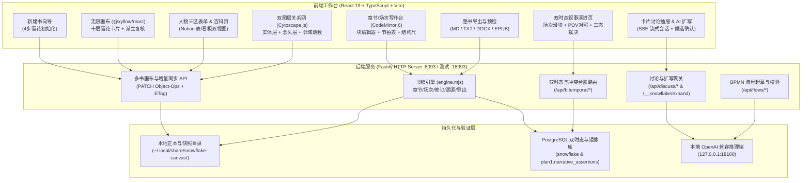

# 雪花画布（Snowflake Canvas v3）

[](./LICENSE)
[](https://nodejs.org/)
[](https://www.typescriptlang.org/)

**雪花画布（Snowflake Canvas v3）** 是一款基于 **兰迪·英格曼森（Randy Ingermanson）十步雪花写作法**、**双时态叙事图谱（Bitemporal Narrative Graph）** 与 **无限画布推演（Infinite Canvas Deduction）** 的 AI 原生小说创作工作台。

它专为长篇虚构叙事、多视角（Multi-POV）群像小说与复杂世界观设定工程打造，将从「一句话核心前提」到「整书章节场次定稿」的全流程收敛在同一套有向无环派生图与双时态信念账本之中。

---

## 目录 / Table of Contents

- [核心特性亮点](#核心特性亮点)
- [系统架构图（Mermaid）](#系统架构图mermaid)
- [环境要求](#环境要求)
- [5 分钟快速启动（Quickstart）](#5-分钟快速启动quickstart)
- [环境变量说明](#环境变量说明)
- [测试运行指南（单元 / 集成 / Playwright E2E）](#测试运行指南单元--集成--playwright-e2e)
- [数据存储与正本结构](#数据存储与正本结构)
- [目录结构](#目录结构)
- [English Overview & Quickstart](#english-overview--quickstart)
- [开源协议（License）](#开源协议license)

---

## 核心特性亮点

1. **十步雪花写作法全链路推演与变更溯源**
   - 严格映射兰迪·英格曼森十步雪花模型：`自由念头 (situation)` → `一句话 (sentence)` → `一段话 (paragraph)` → `人物小传 (renwuxiaozhuan)` → `一页大纲 (yipie)` → `人物详表 (renwubiao)` → `四页大纲 (sipie)` → `人物圣经 (renwushengjing)` → `场景表 (changci)` → `章节骨架 (zhangjie)` → `正文草稿 (prose)`。
   - **派生与复核闭环**：任意上游卡片修改或退回更早层级时，所有下游派生卡片自动标记 `待复核：上游卡片已变更`（`needsReview`），防止大纲改动与正文设定脱节。

2. **无限画布念头讨论与知识沉淀（Provenance-First Sedimentation）**
   - 每张画布卡片拥有独立的多轮 AI 讨论抽屉（`CardDiscuss`），支持 SSE 流式推演、候选扩写（`ExpandPanel`）与「采纳进本念头」。
   - 讨论成果可一键沉淀为书内人物、地点、组织、伏笔或折入具体场次，并在 `provenance` 表与修订历史中记录完整会话 ID、请求 ID 与引文摘要（前 500 字），实现「每一句设定皆可溯源」。

3. **人物三区表单与 Cytoscape 双图层关系网**
   - **人物页（Cast Page）**：支持 Notion 风格数据库表格（排序、搜索、按类别筛选、列宽拖拽持久化）与看板视图（主要/次要/NPC 拖拽分列），展开即见「核心驱动区 + 人物弧光区 + 关系与出场统计区」三区结构化表单。
   - **关系页（Relation Page）**：基于 Cytoscape.js 构建「设定实体层 + 画布念头层」双图层交互式图谱，支持一跳/二跳邻域聚焦、孤立点检测、念头层开关与弧光对照。

4. **章节/场次 Notion 块编辑器与多版本修订**
   - **章节页（Chapter Page）与场次页（Scene Page）**：支持树状章节大纲、场次节拍表（`BeatTable`）、结构尺（`故事八步` / `启程转合` 缺口与失败次数自动诊断）、块级字段（`BlockField`）以及场次正文多版本修订对比（Diff）与无损回滚。
   - 常规编辑采用 `PATCH` 增量操作（`diffDocuments` / `applyObjectOps`）与行级乐观锁（`baseRev` / `ETag`），单次按键传输体积与全书总字数解耦。

5. **双时态叙事设定演进（Bitemporal Narrative & Conflict Ledger）**
   - 将叙事断言分为 **客观正史（Canon Truth）** 与 **角色主观认知（POV Belief）** 双层，绑定场次生效区间 `[valid_from_scene_seq, valid_to_scene_seq)`，由 PostgreSQL 排他约束 `narrative_scene_no_overlap` 杜绝同层同视角设定重叠。
   - 拖动 **场次时间滑块（Scene Slider）** 即可实时对照特定场次下「世界真实发生的事」与「某角色以为的事」，自动高亮 **戏剧反差（Dramatic Irony）**。
   - 内置 **三态设定冲突裁决台**（`新替旧 Supersede` / `分域共存 Coexist` / `驳回 Reject`）与 SHA-256 链式防篡改裁决台账（`LEDGER_OK`）。

6. **工业级导出预检与多格式整书导出**
   - 导出前自动执行空场检测、未回收伏笔与大纲未出场人物预检，并支持一键定位问题场次。
   - 原生支持导出 **Markdown (`.md`)**、**纯文本 (`.txt`)**、**Word (`.docx`)** 与通过 `epubcheck` 严格校验的 **EPUB 3 (`.epub`)** 电子书。

---

## 系统架构图（Mermaid）



---

## 环境要求

- **操作系统**：Linux / macOS（推荐 Ubuntu 22.04+ 或 macOS 14+）
- **Node.js**：`v20.0.0` 及以上（推荐 `v22 LTS`）
- **Python**：`3.10+`（用于辅助清理与运维脚本）
- **可选组件**：
  - `PostgreSQL 15+`（启用 `btree_gist`、`pg_trgm`、`pgcrypto` 扩展，用于双时态叙事图谱与书稿关系镜像）
  - `epubcheck`（用于 EPUB 3 导出格式标准性校验）
  - 本地 OpenAI 兼容推理网关（默认监听 `http://127.0.0.1:18100/v1`，用于 AI 讨论与卡片扩写）

---

## 5 分钟快速启动（Quickstart）

### 1. 克隆仓库并安装依赖

```bash
git clone git@github.com:liuwenpinghaher-commits/snowflake-canvas.git
cd snowflake-canvas
npm install
```

### 2. 配置环境变量

复制环境变量模板并按需修改（默认配置开箱即用，仅绑定回环地址 `127.0.0.1`）：

```bash
cp .env.example .env
```

### 3. 启动开发或生产服务

- **开发页模式（Vite 热更新）**：
  ```bash
  npm run dev
  ```
  开发页默认地址为 `http://127.0.0.1:5173/xuehua/`。

- **完整后端与静态资源生产服务（默认端口 `8093`）**：
  ```bash
  npm run build
  node server/http.mjs
  ```
  服务启动后访问 `http://127.0.0.1:8093/xuehua/` 即可进入雪花画布工作台。

---

## 环境变量说明

所有配置项均通过环境变量读取，绝不硬编码任何密钥或私有地址（详见 [`.env.example`](./.env.example)）：

| 变量名 | 默认值 | 说明 |
| :--- | :--- | :--- |
| `SNOWFLAKE_LISTEN_HOST` | `127.0.0.1` | HTTP 服务监听地址（建议保持回环或受控内网地址） |
| `SNOWFLAKE_PORT` | `8093` | HTTP 服务监听端口（E2E 测试使用隔离端口 `18093`） |
| `SNOWFLAKE_DATA_DIR` | `~/.local/share/snowflake-canvas` | 书稿正本、快照与讨论会话存储根目录 |
| `SNOWFLAKE_EXPAND_PORT` | `18100` | 本地推理服务端口（仅走 `127.0.0.1:<port>`） |
| `CPA_BASE_URL` | `http://127.0.0.1:18100/v1` | 卡片讨论与流程起草使用的 OpenAI 兼容接口地址 |
| `CPA_MODEL` | `deepseek-v3.2` | 讨论与生成默认模型名称 |
| `CPA_API_KEY` | *(空)* | 本地推理网关调用密钥（仅驻留进程内存，绝不落盘到正本） |
| `API_SERVER_KEY` | *(空)* | 本地扩写代理备用密钥 |
| `SNOWFLAKE_PG_MIRROR` | `1` | 是否开启 PostgreSQL 书稿库同步镜像（测试隔离环境可设为 `0`） |
| `SNOWFLAKE_PG_DSN` | *(空)* | PostgreSQL 连接串（未设时回退读取 `server/db/dsn.local`） |

---

## 测试运行指南（单元 / 集成 / Playwright E2E）

> **生产保护红线**：所有自动化测试均在临时数据目录与随机/隔离端口（如 `:18093`）下运行，绝不触碰或重启正在 `:8093` 运行的生产服务，也不修改 `~/.local/share/snowflake-canvas/` 下的生产数据。

### 1. 运行全量单元与集成测试（Vitest）

```bash
npm test
```

包含 43 个测试文件（覆盖十层雪花模型、增量持久化、崩溃恢复日志、多标签锁、AI 扩写安全边界、Notion 表格/看板视图、Cytoscape 关系图、BPMN 流程校验、双时态叙事接口与 R1–R12 验收矩阵）。

### 2. 运行真实业务深度 E2E 测试（Playwright / `@e2e-dev/web`）

E2E 套件会自动在隔离端口 `127.0.0.1:18093` 启动独立测试服务与临时数据目录，驱动真实无头 Chromium 浏览器跑通完整小说创作生命周期：
- 新建小说项目（四步向导）→ 十层雪花法推演与上游变更复核 → 画布念头讨论与沉淀入库 → 人物三区表单与 Cytoscape 双图层关系图交互 → 章节/场次 Notion 块编辑器写作 → 双时态场次滑块/POV 对照/三态冲突裁决 → 整书导出（Markdown / TXT / DOCX / EPUB）。

```bash
npx e2e run
```

---

## 数据存储与正本结构

8093 的数据目录默认位于 `~/.local/share/snowflake-canvas/`（可用 `SNOWFLAKE_DATA_DIR` 改）：

- `books/<bookId>/snowflake.json`：单本书的画布、十层卡片、人物百科、章节场次正本
- `books/<bookId>/session.json`：每张卡片的讨论会话记录（按 `cardId` 分桶）
- `books/<bookId>/snowflake.<YYYYMMDDTHHmmss>.snapshot.json`：点击「留下这一版」或回退前自动保存的本地历史快照
- `active.json`：当前活动书籍指针

如果浏览器在非回环且无目录授权的环境下打开单文件，前端会自动退回下载/另存模式并按 60 秒间隔合并提示；推荐直接通过 `http://127.0.0.1:8093/xuehua/` 访问服务端正本。

---

## 目录结构

```text
snowflake-canvas/
├── src/                        # 前端核心源码 (React 19 + TypeScript)
│   ├── App.tsx                 # 顶层工作台外壳、多书切换、导航与抽屉调度
│   ├── FlowCanvas.tsx          # 无限画布 (@xyflow/react) 与雪花卡片节点
│   ├── SideEditor.tsx          # 右侧卡片属性、层级切换、块级字段与快照面板
│   ├── CardDiscuss.tsx         # 卡片 AI 讨论抽屉与采纳沉淀面板
│   ├── ExpandPanel.tsx         # AI 扩写候选确认面板
│   ├── CharacterPage.tsx       # 人物数据库页（表/看板双视图 + 三区表单）
│   ├── EncyclopediaPage.tsx    # 设定百科与时间线溯源页
│   ├── RelationPage.tsx        # Cytoscape 双图层人物/念头关系图谱页
│   ├── ChapterPage.tsx         # 章节树、场次正文编辑器、节拍表与结构尺
│   ├── ScenePage.tsx           # 场次全局表与跨章拖拽看板页
│   ├── BitemporalPage.tsx      # 双时态设定演进、场次滑块、POV 对照与三态裁决页
│   ├── FlowPage.tsx            # BPMN 业务/叙事流程起草与图表页
│   ├── NewBookWizard.tsx       # 四步新建小说向导
│   ├── BlockField.tsx          # Notion 风格块级富文本编辑器组件
│   ├── document.ts             # 十步雪花核心数据模型、派生链路与复核纯函数
│   └── persist.ts              # 原子写盘、恢复日志、跨标签锁与状态机
├── server/                     # 后端服务源码 (Node.js ESM + Fastify)
│   ├── http.mjs                # 主 HTTP 服务、REST API、SSE 讨论流与静态托管
│   ├── bitemporal.mjs          # 双时态叙事断言、冲突检测与链式台账路由
│   ├── flow-draft.mjs          # 流程自动起草与本地模型调用适配
│   ├── flow-validate.mjs       # BPMN 流程结构与布局校验器
│   └── db/                     # 书稿存储引擎、增量差分、导入导出与 PG 镜像
├── tests/                      # Vitest 单元与集成测试套件 (43 个测试文件)
├── e2e/                        # 真实业务全链路 Playwright E2E 测试与隔离启动器
├── e2e-got-s3/                 # 《权力的游戏·第三季》十章导入与浏览器验收套件
├── scripts/                    # 种子灌库、会话清理与自动化验收脚本
├── .env.example                # 环境变量配置模板
├── CONTRIBUTING.md             # 贡献指南
├── SECURITY.md                 # 安全策略与隐私保护说明
└── LICENSE                     # MIT 开源许可证
```

---

## English Overview & Quickstart

**Snowflake Canvas v3** is an AI-native novel-writing and narrative-engineering workbench built around **Randy Ingermanson's 10-Step Snowflake Method**, a **Bitemporal Narrative Knowledge Graph**, and an **Infinite Visual Canvas**.

### Key Highlights

- **10-Layer Snowflake Deduction & Review Propagation**: Expand a novel from a 1-sentence premise to a 1-paragraph summary, character sheets, 1-page & 4-page synopses, character bibles, scene lists, and chapter prose. Modifying any upstream card automatically flags downstream derived cards for review (`needsReview`).
- **Card Discussion & Provenance-First Sedimentation**: Brainstorm on any canvas card with streaming AI sessions, preview expansion candidates without mutating canonical bytes until confirmed, and sediment insights into book entities or scenes with full provenance tracking.
- **3-Zone Character Forms & Dual-Layer Cytoscape Graph**: Manage characters in Notion-style sortable/filterable tables or drag-and-drop Kanban boards, and explore entity + idea relationships on an interactive Cytoscape.js graph.
- **Bitemporal Narrative Evolution & Conflict Resolution**: Track **Canon Truth** vs. **POV Belief** across scene intervals `[valid_from_scene_seq, valid_to_scene_seq)`. Scrub the scene slider to inspect dramatic irony at any point in the story, and resolve narrative contradictions (`Supersede` / `Coexist` / `Reject`) backed by a SHA-256 hash-chained decision ledger (`LEDGER_OK`).
- **Full-Book Precheck & Multi-Format Export**: Precheck empty scenes, uncollected foreshadowing, and missing character appearances before exporting to **Markdown**, **Plain Text**, **DOCX**, or `epubcheck`-validated **EPUB 3**.

### Quickstart (5 Minutes)

```bash
# 1. Install dependencies
npm install

# 2. Copy environment template
cp .env.example .env

# 3. Run unit & integration tests
npm test

# 4. Build frontend & start server on http://127.0.0.1:8093/xuehua/
npm run build
node server/http.mjs

# 5. Run isolated Playwright E2E suite (uses port 18093 & temp data dir)
npx e2e run
```

---

## 开源协议（License）

本项目采用 [MIT License](./LICENSE) 开源，Copyright (c) 2026 Liu Wenping。
